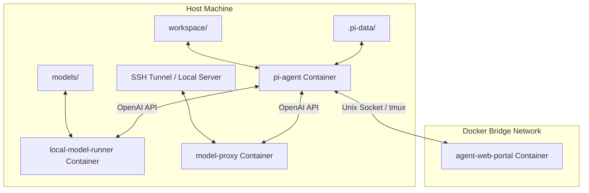

# Agent Developer Guide (AGENTS.md)

Welcome! This guide is designed to help AI agents understand the architecture, operation, and intent of the Pi Coding Agent Container project.

---

## 1. Project Overview & Architecture

This project provides a secure, containerized environment for running the `@earendil-works/pi-coding-agent` terminal coding agent. It is designed to be:
* **Air-gapped / Isolated**: The agent runs in an isolated Docker container with no direct access to the internet.
* **Flexible in Inference**: Can run models locally inside the stack (using `llama.cpp`) or proxy requests to a remote model server/SSH tunnel.
* **Extensible**: The agent persists its state, settings, custom skills, and extensions on the host.

### Diagram: High-Level Stack

---

## 2. Directory Structure

Here are the key directories and files:

* **`workspace/`**: The host directory containing the project code the agent works on.
* **`.pi-data/`**: Configuration, settings, and skills/extensions database for the Pi coding agent.
  * `.pi-data/agent/models.json`: Specifies API provider and model endpoints.
  * `.pi-data/agent/settings.json`: Specifies default model, default provider, thinking settings, etc.
* **`models/`**: Stores local GGUF models (e.g. `gemma-4-12b-it-Q4_K_M.gguf`).
* **`screenshots/`**: Stores visual assets like UI screenshots.
* **`manage.sh`**: The main interface script for building, starting, scanning, and selecting models.
* **`pick.py`**: Interactively selects GGUF models (local or remote) and updates configuration.
* **`.env` / `.env.example`**: Configures the environment variables for Docker Compose.

---

## 3. Configuration (`.env`)

The system automatically initializes `.env` from `.env.example` if it is missing. Key configuration options:

| Variable | Description |
|---|---|
| `HOST_UID` / `HOST_GID` | Maps file permissions inside the container to the host user's UID/GID. |
| `GIT_AUTHOR_NAME` / `GIT_COMMITTER_NAME` | Identity used by the agent when committing changes. |
| `PORTAL_PASSWORD` | Password for accessing the web portal (`pi` user). *Must be set to run the portal.* |
| `MODEL_FILE` | Filename of the GGUF model in the `./models` directory (or remote model identifier). |
| `EXTERNAL_MODEL_PORT` | Port on the host for remote proxy mode (SSH tunnel to remote desktop). |
| `GPU_LAYERS` | Number of layers to offload to the host's GPU (`llama.cpp`). |
| `LLAMA_ARGS` | Additional startup arguments passed to the `llama.cpp` server. |

---

## 4. Key Orchestration Commands (`manage.sh`)

Agents can orchestrate and run the stack using the following actions:

* **`./manage.sh build`**: Builds or rebuilds the Docker containers.
* **`./manage.sh run [args...]`**: Runs the `pi-agent` container interactively in the terminal.
* **`./manage.sh run-proxy [args...]`**: Runs the agent using the SSH tunnel proxy.
* **`./manage.sh up-proxy`**: Starts the `model-proxy`, `pi-agent`, and `agent-web-portal` in the background.
* **`./manage.sh up-runner`**: Runs only the local model runner in the background.
* **`./manage.sh shell`**: Launches a interactive Bash session inside the agent container.
* **`./manage.sh clean`**: Stops and removes all containers and network bridges.
* **`./manage.sh pick`**: Launches the model picker helper.
* **`./manage.sh scan`**: Runs Trivy security vulnerability scans on the built images.

---

## 5. Model Selection (`pick.py` / `./manage.sh pick`)

When `./manage.sh pick` is executed, the `pick.py` script:
1. Searches the `models/` directory for `.gguf` files.
2. Probes `127.0.0.1:$EXTERNAL_MODEL_PORT/v1/models` and `172.28.0.1:$EXTERNAL_MODEL_PORT/v1/models` to discover active remote models (e.g. from an SSH tunnel).
3. Prompts the user/agent to select a model.
4. Overwrites the `MODEL_FILE` variable in `.env`.
5. Updates or creates `.pi-data/agent/models.json` and `.pi-data/agent/settings.json` to reflect the chosen model for the Pi coding agent.

---

## 6. Constraints & Best Practices for Agents

If you are an agent operating in this repository or sandbox, keep these rules in mind:

1. **Air-Gapped Sandbox**:
   The `pi-agent` container has **no internet access**. All outbound network requests from the sandbox will fail. Any tasks requiring web search or package downloads must be run directly on the host (or requested from the host agent/user).
2. **Git Control**:
   The sandbox can track Git locally if the `workspace/` is a repository. However, because the container is air-gapped, any remote operations (`git push`, `git pull`, `git clone`) must be run by the host.
3. **Persisted Agent Settings**:
   If you need to change model configurations, prefer using `./manage.sh pick` or directly editing `.env`, as this automatically propagates updates to both the Docker Compose environment and the Pi agent configuration files in `.pi-data/agent/`.
4. **UID/GID Preservation**:
   Ensure `HOST_UID` and `HOST_GID` are correctly configured in `.env` so files generated inside `workspace/` don't require root permissions to edit on the host.
