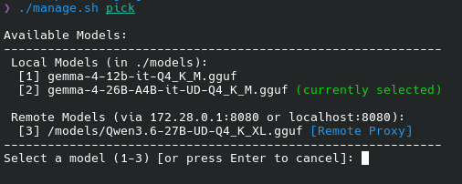
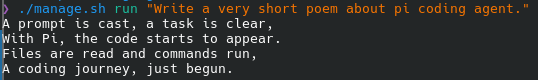
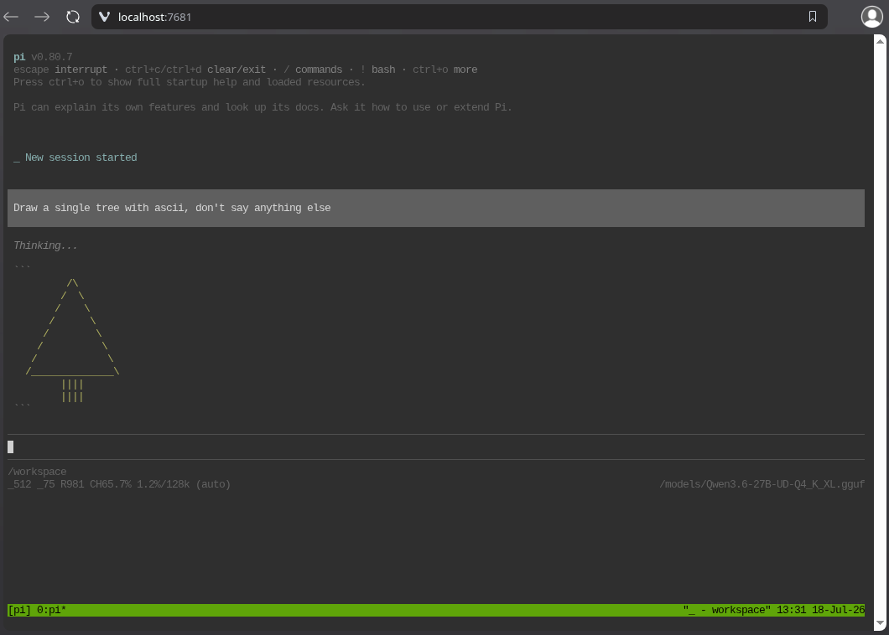

# Pi Coding Agent (Dockerized)

A containerized, secure, and isolated development environment for running the Pi coding agent (`@earendil-works/pi-coding-agent`).

> [!IMPORTANT]
> **Python CLI Migration (v2.0.0) is Active:**
> The repository orchestration layer has been migrated from legacy Bash/Python scripts (`manage.sh` and `pick.py`) to a unified, standalone Python package (`pib`) built using [Typer](https://typer.tiangolo.com/) and managed by [uv](https://github.com/astral-sh/uv).
> 
> * **How to Install:** You can install `pib` globally via `uv` tool system:
>   ```bash
>   uv tool install .
>   ```
> * **How to Run:** Use `pib <command>` (e.g. `pib build`, `pib configure`, `pib run`).
> * **Backwards Compatibility:** `./manage.sh` is now a shell wrapper that automatically delegates to `uv run pib`.
> * **Benefits:** Support for native shell autocompletion (Bash/Zsh/Fish/PowerShell), cleaner command interfaces, and unified configuration.

---

## Table of Contents

- [General Information](#general-information)
  - [Key Features](#key-features)
  - [Mounted Directories](#mounted-directories)
  - [Infrastructure Security & Isolation](#infrastructure-security--isolation)
- [The Pieces](#the-pieces)
  - [Pi-agent](#pi-agent)
  - [Multi-Agent Ledger Orchestrator](#multi-agent-ledger-orchestrator)
  - [llama.cpp](#llamacpp)
  - [ttyd Container](#ttyd-container)
  - [Model Proxy Container](#model-proxy-container)
  - [Orchestration CLI (pib / manage.sh)](#orchestration-cli-pib--managesh)
- [Running and Configuration](#running-and-configuration)
  - [Prerequisites](#prerequisites)
  - [Quick Start](#quick-start)
  - [Web Portal Workspace](#web-portal-workspace)
  - [Local Inference Setup](#local-inference-setup)
  - [Proxy / Remote Inference Setup](#proxy--remote-inference-setup)
  - [Multi-Agent Workflow](#multi-agent-workflow)
  - [Advanced Configurations](#advanced-configurations)
- [Model Files](#model-files)
  - [Why GGUF?](#why-gguf)
  - [Recommended Models](#recommended-models)
- [Screenshots](#screenshots)

---

## General Information

This repository provides a containerized workspace for developer agent operations, designed for security, flexibility, and ease of use.

### Key Features

* **Complete Isolation**: The agent runs in an unprivileged, air-gapped Docker container with no direct access to your local network or the internet.
* **Flexible Model Inference**: Easily route traffic to a local llama.cpp runner or proxy requests to a remote model server via a secure SSH tunnel.
* **Aggressively Extensible**: Maintains the pi agents ability to self-author skills and extensions.
* **Web Portal Shell**: Start the stack and interact with the agent workspace from any browser using a lightweight web terminal.

### Mounted Directories

To enforce security and isolation, the containerized agent has access to only two host-mounted directories. These are the only areas of the host filesystem the agent can view or modify, and each serves a distinct purpose:

* **`workspace/`**: The target development area where the agent operates. Place the source code or project files you want the agent to work on here.
* **`.pi-data/`**: The agent's persistent configuration and storage area. This holds global configurations, settings, API keys, session history, and agent enhancements (skills and extensions) across container restarts.

### Infrastructure Security & Isolation

* **Network Isolation**: The agent container runs completely isolated on an air-gapped internal bridge network with no routing to the internet or the host's LAN.
* **Inference Server Exposure**: The local model runner (`llama.cpp` server) publishes its port bound only to localhost/loopback (`127.0.0.1`) on the host.
* **Supply Chain Security**: All Docker base images, third-party containers (`socat`, `ttyd`), and the default `llama.cpp` model runner are pinned to exact cryptographic SHA-256 digests rather than mutable tags. The `@earendil-works/pi-coding-agent` npm package is pinned to a specific release and installed with scripts ignored (`--ignore-scripts`) to prevent arbitrary build-time code execution from compromised upstream transitive dependencies. You can run `pib scan` at any time to execute a local security vulnerability audit of the container images via Trivy.
* **Unprivileged Execution**: Processes in the agent container run under the `node` user (UID 1000). Host mapping prevents files written inside `workspace/` from becoming owned by `root`.
* **Filesystem Restrictions**: The agent's root filesystem is mounted as read-only. Writable directories (`/tmp`, `/home/node/.config`, `/home/node/.npm`) are backed by non-executable memory storage (`tmpfs`).
* **Web Portal Security**: The web portal container runs as a non-root user matching your host's UID/GID, has all system capabilities dropped (`cap_drop: [ALL]`), is mounted read-only with a temporary writable `/tmp` via `tmpfs`, has `no-new-privileges:true` set, requires password authentication (`pi` user with `PORTAL_PASSWORD`), publishes its port bound only to loopback (`127.0.0.1`), and communicates with the agent exclusively over a `tmux` session shared via a Unix domain socket inside a named volume.

---

## The Pieces

### Pi-agent

**Pi** (`@earendil-works/pi-coding-agent`) is the terminal coding agent that powers this workspace. It is a minimal, aggressively extensible coding harness designed to adapt to your workflows. It ships with four built-in tools (`read`, `bash`, `edit`, `write`) and avoids opinionated features like sub-agents or permission popups.

#### Pi Enhances Itself

During a session, Pi can write enhancements to itself. These persist on the host filesystem inside the mounted `.pi-data/` directory (mapped from `/home/node/.pi/`):

* **Skills**: Self-contained Markdown-based capability packages loaded on-demand. They provide instructions, helper scripts, and reference documentation for specific tasks (e.g., loaded via `/skill:name` or matched automatically).
* **Extensions**: TypeScript modules that extend Pi with custom tools, commands, event handlers, keyboard shortcuts, and UI components.
* **Codemode**: Built-in client-side JavaScript execution sandbox. The model writes scripts to chain tool calls, process large data streams, and filter results directly inside the container without blowing up context window token limits.
* **Model Context Protocol (MCP)**: Native support for local stdio MCP servers declared in `.pi-data/agent/mcp.json` or `/workspace/.pi/mcp.json`.
* **Prompt Templates**: Markdown files placed in `.pi-data/agent/prompts/` (e.g. `review.md`, `test.md`) automatically surface as interactive `/review` or `/test` slash commands.
* **Session Controls**: Resume previous work instantly using `pib run -c` (continue latest session) or `pib run -r` (interactive session picker).
* **Virtual Models**: Extensions can register virtual models (`pi.registerVirtualModel`) that dynamically route requests to different physical model endpoints per turn based on task type or reasoning effort.

| Container Path | Host Path | Purpose |
|---|---|---|
| `/home/node/.pi/agent/skills/` | `.pi-data/agent/skills/` | Global skills |
| `/home/node/.pi/agent/extensions/` | `.pi-data/agent/extensions/` | Global extensions |
| `/home/node/.pi/agent/prompts/` | `.pi-data/agent/prompts/` | Global prompt templates (slash commands) |
| `/home/node/.pi/agent/mcp.json` | `.pi-data/agent/mcp.json` | Global MCP server definitions |
| `/home/node/.pi/agent/themes/` | `.pi-data/agent/themes/` | Custom terminal UI themes |

> [!TIP]
> Ask Pi to build a skill, prompt template, or extension whenever you need a recurring capability (e.g., _"Write a skill for deploying Docker containers"_, _"Create an extension that auto-commits after each task"_, or _"Add an MCP server for SQLite database analysis"_). Pi will write the files directly to `.pi-data/` so they are active on subsequent runs.

### Multi-Agent Ledger Orchestrator

Bundled inside `.pi-data/agent/` is a standalone, zero-dependency implementation of **GVS5H ledger-based zero-shot self-orchestration**:

* **Skill (`.pi-data/agent/skills/multiagent/`)**: Provides `SKILL.md` and `scripts/multiagent.py`, coordinating fresh LLM contexts (Primary Planner, Ideation Worker, Primary Manager, Task Workers, and Cutoff Summarizer) through a shared filesystem ledger (`plan.md`, `notes.md`, `tasks.json`, `solution.py`/`answer.md`, and `transcript.jsonl`).
* **Pi 1.0+ Extension (`.pi-data/agent/extensions/multiagent.ts`)**: Registers a model-callable `multiagent` tool and an interactive `/multiagent` slash command. When a workflow is launched asynchronously (`--bg`), the extension tracks its progress in the TUI status bar and uses Pi 1.0's `pi.sendMessage(..., { triggerTurn: true })` API to automatically wake Pi up and deliver the completed artifact mid-conversation.

### llama.cpp

The `local-model-runner` service runs `llama.cpp` to provide local inference for the agent. It loads GGUF model files from the host-mounted `./models/` directory and exposes an OpenAI-compatible API endpoint inside the container network.

For details on supported model formats and recommended models, see [Model Files](#model-files).

### ttyd Container

A lightweight web-based terminal (`ttyd`) container that allows you to access and interact with the agent's workspace directly from a web browser by attaching to a shared `tmux` session in the agent container via a Unix socket inside a shared volume.

### Model Proxy Container

An internal network proxy container (powered by `socat`) that acts as a secure bridge, forwarding requests from the air-gapped agent container to an external model server or SSH tunnel endpoint on the host.

### Orchestration CLI (`pib` / `manage.sh`)

The container stack is managed via the `pib` command-line interface (or the backwards-compatible `./manage.sh` wrapper script):

* **`pib build`** / **`./manage.sh build`**: Builds/rebuilds the agent and web portal containers.
* **`pib update`** / **`./manage.sh update`**: Force-rebuilds the containers bypassing Docker cache.
* **`pib run [args...]`** / **`./manage.sh run [args...]`**: Performs directory setup and launches the interactive agent container, overriding the background keep-alive.
* **`pib run-proxy [args...]`** / **`./manage.sh run-proxy [args...]`**: Starts the model-proxy and launches the agent.
* **`pib up-proxy`** / **`./manage.sh up-proxy`**: Starts the proxy, portal, and agent services in the background.
* **`pib up-runner`** / **`./manage.sh up-runner`**: Starts only the local model runner container in the background.
* **`pib shell`** / **`./manage.sh shell`**: Spawns a bash terminal inside a temporary instance of the agent container for sandbox experimentation.
* **`pib clean`** / **`./manage.sh clean`**: Tears down active containers and shuts down internal network bridges.
* **`pib configure`** (or **`pib pick`** / **`./manage.sh pick`**): Consolidates model family, model size selection, and hardware profile configuration into a single interactive wizard.
* **`pib profile [name|clear]`** / **`./manage.sh profile [name|clear]`**: Lists, switches, or clears the active hardware/model configuration profile.
* **`pib scan`** / **`./manage.sh scan`**: Runs a security vulnerability audit against all built and pulled images in the container stack (`agent`, `portal`, `socat`, and `llama.cpp`) using Trivy.
* **`pib test`** / **`./manage.sh test`**: Runs the Python unit test suite.

#### Shell Auto-Completion Setup

Once `pib` is installed (`uv tool install .`), you can generate shell auto-completion scripts for your shell:

* **Fish Shell**:
  ```bash
  pib --show-completion fish > ~/.config/fish/completions/pib.fish
  ```
* **Zsh**:
  ```bash
  pib --show-completion zsh > ~/.zshrc.d/_pib
  ```
* **Bash**:
  ```bash
  pib --show-completion bash > ~/.local/share/bash-completion/completions/pib
  ```

---

## Running and Configuration

### Prerequisites

Before starting, ensure your host environment has:
1. **Docker & Docker Compose** installed.
2. **NVIDIA Container Toolkit** (optional, required if you want to offload model inference to an NVIDIA GPU).
3. **[uv](https://github.com/astral-sh/uv) & Python 3.10+** (for running or globally installing the `pib` CLI via `uv tool install .`).

### Quick Start

#### 1. Initialize and Configure the Environment

Running any orchestration command (such as `pib build` below) will automatically generate your local `.env` configuration file from `.env.example` if it doesn't already exist. 

Open `.env` in a text editor and configure:
* **File Permissions**: Verify `HOST_UID` and `HOST_GID` match your host user (run `id -u` and `id -g`).
* **Git Identity**: Fill in your Git name and email so the agent's commits are correctly attributed to you.
* **Model Runner**: Set `MODEL_RUNNER_IMAGE` (use `:server-cuda` for GPU or `:server` for CPU) and place your GGUF model file inside the `./models/` directory.

#### 2. Build the Containers

Build the isolated agent and web portal images:
```bash
pib build
```

#### 3. Run the Agent

To start an interactive command-line session with the agent:
```bash
pib run
```
You can also pass arguments directly to the agent CLI:
```bash
# Get the agent version
pib run --version

# Log in to the agent
pib run /login

# Provide a direct coding instruction
pib run "Write a fast Fibonacci sequence calculator in Rust"
```

### Web Portal Workspace

To run the agent with a browser-based web terminal:

1. **Configure Credentials**: Ensure you have set a password for `PORTAL_PASSWORD` in your `.env` file. The web portal will refuse to start if this is left empty or unset.
2. **Start the Stack**: It is highly recommended to use the global `pib` CLI, as it automatically handles configuring and exporting the pinned image versions for you. If you choose to run `docker compose` directly, you must pass the environment files:
   * **Via `pib` CLI (Recommended)**:
     ```bash
     pib up-proxy
     ```
   * **Via direct `docker compose`**:
     ```bash
     docker compose --env-file pinned-versions.env --env-file .env --profile portal up -d
     ```
3. **Access the Portal**: Open your browser and navigate to `http://localhost:7681`. Log in using the username `pi` and your configured `PORTAL_PASSWORD` to launch the interactive `pi` agent CLI.

#### Security & Remote Access

* **Localhost Binding**: By default, the web portal is configured to bind only to the loopback interface (`127.0.0.1:7681`) on the host. This prevents other hosts on your local area network (LAN) from accessing the session.
* **Remote Access via SSH Tunnel**: If you need to access the portal remotely, the simplest secure option is to use an SSH tunnel to securely forward the port:
  ```bash
  ssh -L 7681:localhost:7681 user@remote-host
  ```
  Then access the portal at `http://localhost:7681` on your local machine.
* **LAN Exposure Warning**: Exposing the portal to the LAN requires deliberately changing the bind in `docker-compose.yml` (e.g. from `127.0.0.1:7681:7681` to `0.0.0.0:7681:7681`) and is not recommended without setting up TLS termination (e.g. Nginx, Caddy, or another reverse proxy with HTTPS) in front to protect credentials and session traffic.

### Local Inference Setup

The local inference engine runs llama.cpp. To configure the agent to communicate with the local runner, configure the following files in `.pi-data/agent/`:

#### `.pi-data/agent/models.json`

```json
{
  "providers": {
    "llama-cpp": {
      "baseUrl": "http://local-model-runner:8080/v1",
      "api": "openai-completions",
      "apiKey": "none",
      "models": [
        {
          "id": "gemma-4-26B-A4B-it-GGUF"
        }
      ]
    }
  }
}
```

#### `.pi-data/agent/settings.json`

```json
{
  "defaultProvider": "llama-cpp",
  "defaultModel": "gemma-4-26B-A4B-it-GGUF",
  "autocompleteMaxVisible": 7,
  "defaultThinkingLevel": "off"
}
```

### Proxy / Remote Inference Setup

If you are running the `pi-agent` and the web portal on one machine (e.g., your laptop) but running your model server on a remote machine (e.g., a desktop with a GPU), you can route LLM traffic over a secure SSH tunnel without giving the agent container any external network access.

This is achieved using the `model-proxy` service (powered by `socat`), which sits on both the isolated `internal_network` and the `external_network`. It acts as a gateway, forwarding internal requests from `local-model-runner:8080` to `host.docker.internal:<EXTERNAL_MODEL_PORT>` on your host.

The default host port is `8080`. If you need to use a different port (e.g., because `8080` is already in use on your host), you can customize it by setting `EXTERNAL_MODEL_PORT` in your `.env` file.

#### Step 1: Establish the SSH Tunnel

Run this command in a terminal on your client laptop to forward your desktop's model server port (normally `8080`) to the configured `EXTERNAL_MODEL_PORT` on your local machine.

To prevent exposing your remote model runner to your entire local area network (LAN), do **not** use the `-g` (GatewayPorts) option. Instead, bind the forwarded port directly to the Docker bridge gateway address (`172.28.0.1`):
```bash
ssh -L 172.28.0.1:<EXTERNAL_MODEL_PORT>:localhost:8080 user@remote-desktop
```

> [!NOTE]
> On a fresh clone, the Docker network bridge interface (`172.28.0.1`) will not exist on your host yet. If the SSH command fails with `bind: Cannot assign requested address`, run `pib build` (or any other orchestration command) first to initialize the Docker networks and containers on your host.

#### Step 2: Configure your Firewall (if UFW is active)

By default, firewalls like UFW block incoming traffic from Docker bridge interfaces to the host. Since the `model-proxy` container must communicate with the host's forwarded port, you must explicitly allow the specific Docker compose network subnet (`172.28.0.0/24`) to connect to your host's forwarded port:
```bash
sudo ufw allow from 172.28.0.0/24 to any port <EXTERNAL_MODEL_PORT> proto tcp
```

#### Step 3: Run the Services

* **Interactive CLI**:
  Run the agent interactively in your terminal:
  ```bash
  pib run-proxy
  ```
* **Web Portal + Background Agent**:
  Start the stack in detached mode:
  ```bash
  pib up-proxy
  ```
  Open http://localhost:7681 in your browser and log in with username `pi` and your configured `PORTAL_PASSWORD` to access the interactive web shell.

#### Running the Model Runner on a Remote GPU Host

If you are running the `llama.cpp` local inference runner on a remote GPU host machine (without the agent or proxy services), you can start only the runner using the following command:
```bash
pib up-runner
```
Alternatively, you can start it via Docker Compose (ensure you pass the environment files):
```bash
docker compose --env-file pinned-versions.env --env-file .env --profile runner up -d
```

### Multi-Agent Workflow

The container includes a standalone, benchmark-free implementation of the **GVS5H ledger-based multi-agent workflow** (`.pi-data/agent/skills/multiagent/` and `.pi-data/agent/extensions/multiagent.ts`).

#### How the Ledger Workflow Operates

Instead of a single long conversation that accumulates dead-end reasoning, the orchestrator coordinates fresh model invocations against the container's active LLM endpoint (`http://local-model-runner:8080/v1`, whether served by `local-model-runner` or `model-proxy`) through a shared filesystem directory (`/workspace/.multiagent/<run-id>/`):

1. **Primary Planner (`plan.md`, `tasks.json`)**: Decomposes the problem into a 3–6 sentence strategy and an initial task list.
2. **Ideation Worker (`notes.md`)**: Brainstorms multiple genuinely distinct candidate approaches and pitfalls in prose before any code is written.
3. **Primary Manager (`tasks.json`)**: Reviews current work, notes, and ground-truth verification output (`--test-cmd`), curates the task list, pivots away from stuck approaches, and assigns the single highest-value next task.
4. **Task Workers (`solution.py` or `answer.md`, `notes.md`)**: Execute one task in a fresh context window, update the candidate solution, and rewrite/compact `notes.md` so context never bloats.

#### Running Asynchronously in Pi

You can launch and monitor multi-agent workflows in three ways:

1. **Via the Interactive `/multiagent` Slash Command**:
   ```text
   /multiagent Design and implement a lock-free ring buffer in Python
   /multiagent status
   /multiagent probe
   /multiagent stop <run-id>
   ```
   When launched, the `.pi-data/agent/extensions/multiagent.ts` extension runs the workflow asynchronously in the background, displays live iteration progress in the TUI status bar (`multiagent[<id>]: worker (2/10)`), and automatically triggers a follow-up message in Pi (`pi.sendMessage(..., { triggerTurn: true })`) the moment the background run completes.
2. **Via the Model-Callable `multiagent` Tool or `/skill:multiagent`**:
   Ask Pi directly (e.g., *"Use the multiagent tool in the background to solve this and run `pytest -q` as the verification command"*).
3. **Directly via the CLI inside the Container Shell**:
   ```bash
   # Launch detached in the background with automated test verification
   python3 ~/.pi/agent/skills/multiagent/scripts/multiagent.py \
     --bg --run-id ringbuf --test-cmd "pytest -q" --out /workspace/ringbuf.py \
     "Implement a thread-safe ring buffer with unit tests."

   # Inspect live ledger status
   python3 ~/.pi/agent/skills/multiagent/scripts/multiagent.py --status ringbuf
   ```

### Advanced Configurations

#### Git Identity & Local Checkpoints

The agent utilizes Git locally inside the container to track its file changes, create rollback checkpoints, and commit completed tasks.

If the host's `./workspace` directory is initialized as a Git repository (e.g., via `git init` or by cloning a repository into it), the containerized agent will automatically detect it and use the Git identity configured in your `.env` to sign and attribute its commits.

Because the container runs in an air-gapped network, **remote Git operations (such as `git push`, `git pull`, or cloning external repositories) must be run from your host machine.**

---

## Model Files

### Why GGUF?

GGUF (GGML Unified Format) is a binary file format designed for fast loading and saving of models, and for ease of reading, for inference with GGML and GGML-based executors (such as `llama.cpp`). It is the easiest format to start with due to several key design features:
- **Single-File Deployment**: All information needed to load the model (including weights, tokenizer configurations, and hyperparameters) is self-contained in a single `.gguf` file, eliminating the need for external configuration files.
- **Key-Value Metadata Structure**: GGUF utilizes a key-value structure for metadata (hyperparameters). This makes it highly extensible, allowing new information/features to be annotated to the model without breaking compatibility with existing executors.
- **`mmap` Compatibility**: GGUF models can be loaded using memory mapping (`mmap`) for extremely fast loading.
- **Quantization Support**: GGUF natively supports quantized formats (such as 4-bit, 5-bit, or 8-bit precision). Quantization reduces the memory (RAM/VRAM) required to run the models by up to 70%+ while retaining almost all of their baseline intelligence and reasoning capability.

### Recommended Models

For agentic coding and reasoning tasks, **Gemma 4** (by Google) and **Qwen 3.6** (by Alibaba) are excellent starting points. They offer strong code-generation, tool-use, and instructions-following capabilities.

The list below shows the approximate file sizes for their `Q4_K_M` (4-bit quantized, medium) versions, which represent an excellent balance of inference speed, memory usage, and quality:

#### Gemma 4 Family
*   **Gemma 4 E2B** (~2.3B parameters): **~3.11 GB** (Ideal for low-end laptops/mobile devices)
*   **Gemma 4 E4B** (~4.5B parameters): **~4.98 GB** (Good for entry-level devices)
*   **Gemma 4 12B** (~12B parameters): **~7.00 GB** (Excellent balance for consumer GPUs)
*   **Gemma 4 26B A4B** (~25.2B parameters, MoE): **~16.9 GB** (Highly optimized Mixture-of-Experts)
*   **Gemma 4 31B** (~31B parameters, Dense): **~18.3 GB** (Flagship reasoning model for workstations/servers)

#### Qwen 3.6 Family
*   **Qwen 3.6-27B** (~27B parameters, Dense): **~16–17 GB** (Great sweet spot for high-end consumer GPUs)
*   **Qwen 3.6-35B-A3B** (~35B parameters, MoE): **~20–23 GB** (Highly capable Mixture-of-Experts)

> [!TIP]
> Ensure your system has enough combined RAM/VRAM to fit the selected GGUF file size, plus an additional 2–3 GB for context window overhead (KV cache) and general runtime overhead.

---

## Screenshots

### Model Selection CLI (`pib configure`)

Interactive CLI model selector showing local GGUF models and remote model proxy options:



### Prompt Execution CLI (`pib run`)

Running a single prompt non-interactively using the default print mode:



### Web Portal Workspace

Interactive web-based terminal interface accessing the agent's workspace via a browser:


